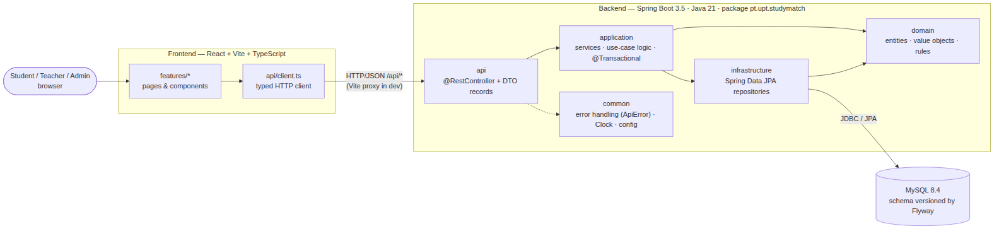
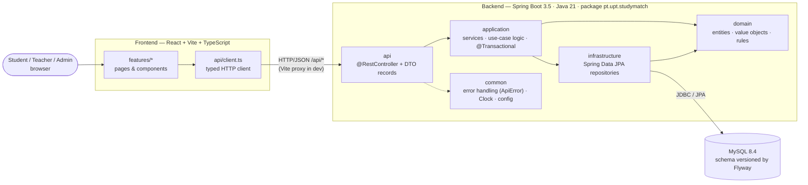

# Architecture — v1 (Sprint 1)

- **Status:** Proposed for Sprint 1 — expected to evolve with each sprint
- **Issue:** #13 · Related: [ADR-0001](../decisions/ADR-0001-technology-stack.md), [domain model](../domain/README.md)

StudyMatch is a **three-tier web application**: a React single-page app talks to a Spring Boot REST API over JSON, and the API stores data in MySQL. Inside the backend the code is organised **by feature** (student, academic, competency, profile, grouping…), and each feature has the same four layers. Business rules live in the **domain** and **application** layers, never in controllers, React components or SQL.

## Components and responsibilities

| Component | Responsibility | Depends on |
|---|---|---|
| **Frontend – features** (`frontend/src/features/*`) | Screens per feature (student list, profile, grouping…). Presentation state only: loading, empty, error. | API client |
| **Frontend – API client** (`frontend/src/api`) | Single place for HTTP calls and TypeScript types that mirror the API contract. | Backend API |
| **Backend – api** (`<feature>/api`) | REST endpoints, request validation, mapping domain ↔ DTO records. No business rules. | application |
| **Backend – application** (`<feature>/application`) | Use cases (e.g. *list students*, later *compute profile*, *form groups*). Transactions, orchestration, throws domain exceptions. | domain, infrastructure |
| **Backend – domain** (`<feature>/domain`) | Entities and rules (e.g. student year 1–5, grade 0–20, group size limits). Pure Java logic, easy to unit-test. | — |
| **Backend – infrastructure** (`<feature>/infrastructure`) | Persistence through Spring Data JPA repositories; later CSV import and external integrations. | domain, MySQL |
| **Backend – common** | Cross-cutting: `GlobalExceptionHandler` → `ApiError {code, message, details}`, `Clock` bean, configuration. | — |
| **Database** | MySQL 8.4 in Docker Compose (local) / managed MySQL (demo). Schema owned by **Flyway** migrations (`V1__…`, `V2__…`); Hibernate only validates (`ddl-auto: validate`). | — |

## Dependency rules

1. Dependencies point **inwards**: `api → application → domain`. The domain depends on nothing else in the project.
2. Controllers never call repositories directly; they go through an application service.
3. Features talk to each other only through application services, never through another feature's repositories. For example, *grouping* asks *profile* for competency levels.
4. Entities never leave the backend: the API returns DTO records, so the database schema can change without breaking the frontend.

## Frontend ↔ backend communication

- REST over HTTP with JSON, under the `/api` prefix (e.g. `GET /api/health`, `GET /api/students`, `GET /api/students/{id}`).
- Errors use one format: `{"code":"NOT_FOUND","message":"…","details":[]}` with the matching HTTP status.
- In development, the Vite dev server proxies `/api` to `http://localhost:8080`, so CORS is not needed.
- Authentication (planned for Sprint 2): JWT bearer token in the `Authorization` header. It sits behind an interface so university SSO can replace it later.

## Persistence approach

- Relational model in MySQL, because the academic domain is highly relational: students, course units, enrolments, attempts, competencies.
- Every schema change is a new Flyway migration. Migrations that have already been applied are never edited.
- Seed data is fictitious only, with no real student data.
- Integration tests run against a real MySQL through Testcontainers; unit tests mock the repositories.

## Where business rules live

| Rule type | Location | Example |
|---|---|---|
| Invariants of one entity | `domain` (constructor/methods) | A student's year is between 1 and 5 |
| Rules across entities / use-case flow | `application` services | Only the final passed attempt counts as evidence |
| Algorithms (profile, matching) | `domain` services, pure functions | Competency level from weighted grades; group score |
| Input format checks | `api` (Bean Validation) | Required fields, email format |
| Data integrity backup | Database constraints | `UNIQUE(number)`, `CHECK(current_year BETWEEN 1 AND 5)` |

## Planned evolution

| Sprint | Change |
|---|---|
| 2 | New features `academic` (UCs, enrolments, grades, CSV import), `competency`, `profile`; authentication |
| 3+ | `grouping` (contexts, constraints, matching algorithm); performance tests on matching |

Running everything locally takes three commands: `docker compose up -d mysql`, then `cd backend && ./mvnw spring-boot:run`, then `cd frontend && npm run dev`. The app is at http://localhost:5173.
